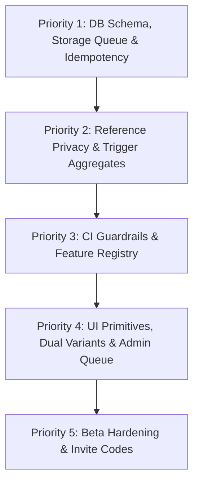

# MORS — Repository Reality Check & Audit (v3)

**Date:** 2026-11-10  
**Auditor:** Antigravity AI Pair Programmer  
**Specification Baseline:** `docs/IMPLEMENTATION_PLAN.md` (v3 master spec) & `docs/PHASES.md` (v3 phases)  
**Status:** Complete Audit across Phases 0–14  

---

## 1. Executive Summary

This audit assesses the current MORS codebase against the newly adopted v3 Master Specification (`docs/IMPLEMENTATION_PLAN.md` and `docs/PHASES.md`). 

The codebase has strong foundational implementations across authentication, core food logging, feeds, collections, search, and RLS security. **Zero tables lack RLS (19/19 tables verified)**, **zero mock data exists in production app code**, and **zero unhandled console.log statements exist** outside of stubbed observability adapters.

However, against the upgraded v3 architectural and privacy requirements, several structural gaps have been identified:
1. **Unlisted Reference Data:** Dishes and places do not yet have the `is_listed` column and start visible globally rather than visible only to creators until used in public entries.
2. **Community Aggregates:** `dish_public_stats` and `place_public_stats` are currently database `VIEW`s rather than trigger-maintained tables.
3. **Storage Cleanup Queue:** Physical image deletions from Supabase storage buckets are not yet handled via an asynchronous transactional `storage_cleanup_queue`.
4. **Idempotency & Timezone:** `food_experiences` lacks `client_request_id uuid` idempotency and `eaten_date` with `profiles.timezone`.
5. **Guardrail Scripts & Feature Registry:** `scripts/check-rls`, `scripts/check-nofake`, `scripts/check-secrets`, and `docs/FEATURE_REGISTRY.md` need to be established in CI.
6. **Tokens Package:** Tokens currently reside in CSS variables and Tailwind theme files rather than an isolated `packages/tokens` package.
7. **Admin Moderation Queue:** The `/admin` moderation queue and `moderation_actions` table are not yet built.
8. **Dual-Variant Photo Compression:** Images are currently client-compressed to a single 2048px file rather than two client-generated variants (display 1280px, thumb 400px).

---

## 2. Phase-by-Phase Audit Matrix (Phases 0–14)

| Phase | Title | Status | Evidence & Observations |
|---|---|---|---|
| **Phase 0** | Repo, tooling, guardrails | **Incomplete** | **Working:** pnpm monorepo with Turborepo, Next.js App Router, TypeScript strict, Vitest, Playwright, Supabase CLI (`package.json:5-16`). **Gaps:** Missing `packages/tokens`, `scripts/check-rls`, `scripts/check-nofake`, `scripts/check-secrets`, `scripts/allowed-placeholders.json`, and `docs/FEATURE_REGISTRY.md`. |
| **Phase 1** | Database foundation & authorization | **Incomplete** | **Working:** Extensions, enums, RLS policies on all 19 public tables, bidirectional blocks, follower relationships, `is_blocked_bidirectional`, `can_view_experience` (`supabase/migrations/20261110000001_initial_schema.sql`). **Gaps:** `dishes` and `places` lack `is_listed` unlisted-by-default behavior; `food_experiences` lacks `eaten_date` and `client_request_id`; `profiles` lacks `timezone`; missing `storage_cleanup_queue` table; missing trigger-maintained `dish_public_stats` and `place_public_stats` tables (currently views). |
| **Phase 2** | Design system & app shell | **Incomplete** | **Working:** Design tokens in CSS vars (`apps/web/src/app/globals.css`), typography (Newsreader + sans body), Button, Input, Textarea, Avatar, ExperienceCard, RatingStars with half-star keyboard navigation, `/dev/ui` gallery (`apps/web/src/app/dev/ui/page.tsx`). **Gaps:** `packages/tokens` not extracted; missing standalone `ImageWithBlur` (blurhash reserved aspect ratio); Radix UI / React Aria headless primitives not yet integrated for dialogs/sheets/comboboxes (custom modals currently used); Toast and ErrorState components not standardized. |
| **Phase 3** | Auth, onboarding, profiles | **Complete** | **Working:** Supabase SSR auth (`apps/web/src/lib/supabase`), `/auth/login`, `/auth/register`, `/auth/callback`, `/auth/reset-password`, 3-step onboarding (`/onboarding`), `/u/[username]` with header, stats, and private locked account state (`apps/web/src/app/u/[username]/page.tsx`), `/settings` with profile editing, avatar upload, and privacy toggles. Follow button properly deferred or conditionally active. |
| **Phase 4** | Quick Log & photo pipeline | **Incomplete** | **Working:** Prominent Log button in AppShell, `LogModal.tsx` modal, `create_experience` RPC with transactional write across experiences, dishes, and photos (`20261110000002_experience_rpcs.sql`), EXIF stripping via canvas redraw (`apps/web/src/lib/media/image.ts`), `/e/[id]` detail view. **Gaps:** Client currently compresses to single 2048px file rather than 2 variants (display 1280px + thumb 400px); missing `client_request_id` idempotency in `create_experience`; missing `storage_cleanup_queue` on entry deletion. |
| **Phase 5** | Full logging: details, drafts, edit, recents, log again | **Incomplete** | **Working:** Detailed logging with multi-dish, category selector, place combobox, price, cuisine, tags, description, ratings (`LogModal.tsx:47-65`), edit published entries via `update_experience` (`20261110000002_experience_rpcs.sql`), delete entry modal. **Gaps:** Local IndexedDB draft autosave and blur recovery not implemented (only server "Save as Draft" button); "Recent dishes" and "Recent places" chips missing at picker heads; "Log again" button missing from detail page and diary rows. |
| **Phase 6** | Diary & personal archive | **Complete** | **Working:** `/diary` page with Timeline and Calendar views (`apps/web/src/app/diary/page.tsx`), timeline keyset pagination via `get_diary_timeline`, calendar month aggregation via `get_diary_calendar_month` (`20261110000004_diary_rpcs.sql`), URL-synced `FilterBar.tsx` (category, rating, date range), `OnThisDayCard.tsx`. |
| **Phase 7** | Canonical dishes/places & community ratings | **Incomplete** | **Working:** Canonical entities (`dishes`, `places`, `dish_aliases`), admin merge RPCs `merge_dishes` and `merge_places` (`20261110000005_canonical_merges.sql`), `/dish/[slug]` and `/place/[id]` pages, separate display of viewer's own rating vs community aggregate. **Gaps:** `dish_public_stats` and `place_public_stats` are views instead of trigger-maintained tables; community rating average is displayed even with 1 rating instead of enforcing the $\ge 3$ ratings de-anonymization threshold ("Not enough ratings yet"); unlisted-by-default logic for new user-created dishes/places missing. |
| **Phase 8** | Social graph & home feed | **Complete** | **Working:** Follow/unfollow, pending follow requests for private profiles, bidirectional blocking with content and follow removal (`20261110000006_social_and_home_feed.sql`), chronological home feed via `get_home_feed` keyset pagination (`apps/web/src/app/page.tsx`), cold start suggestions via `get_suggested_profiles` (`PeopleToFollow.tsx`), follow button state machine. |
| **Phase 9** | Engagement, notifications, reporting, moderation | **Incomplete** | **Working:** Likes (`experience_likes`), flat comments (`experience_comments`), DB trigger notifications (`notifications`), `/notifications` page with mark as read (`apps/web/src/app/notifications/page.tsx`), user reporting modal (`ReportModal.tsx` into `reports` table), sliding-window rate limit buckets (`20261110000007_engagement_notifications.sql`). **Gaps:** Missing `/admin` moderation queue and `moderation_actions` table; missing Realtime notifications subscription. |
| **Phase 10** | Collections and Saved | **Incomplete** | **Working:** Collections CRUD, items support (experiences, dishes, places), fractional ordering with row rebalancing (`20261110000008_collections.sql`), unlisted collections via secret tokens (`/c/[id]?token=...`), collection likes, Save to Collection modal (`SaveToCollectionModal.tsx`). **Gaps:** Currently implements user wishlist via `is_wishlist` rather than a unified private system collection `system_key='saved'` with one-tap bookmarking; unlisted collection token lookup currently exposed via UUID instead of dedicated `get_collection_by_token(token)` security definer RPC. |
| **Phase 11** | Search | **Complete** | **Working:** Security Invoker RPC `search_all` combining pg_trgm trigram similarity (`similarity > 0.25`), case-insensitive ILIKE, and tsvector matching across users, dishes, places, public experiences, and collections (`20261110000009_search.sql`), `/search` page with category tabs and city filter (`SearchClientView.tsx`), 200ms debounce typeahead suggestions (`getSearchSuggestions`). |
| **Phase 12** | Account lifecycle, abuse protection, security | **Incomplete** | **Working:** 14-day deletion grace period via `request_account_deletion` and `cancel_account_deletion`, hard delete cascading RPC `execute_account_hard_delete` (`20261110000010_lifecycle_and_ratelimit.sql`), JSON data export (`exportUserData`), magic byte sniffing upload validation (`apps/web/src/lib/media/validator.ts`), legal pages (`/terms`, `/privacy`, `/community-guidelines`). **Gaps:** Physical image removal from Supabase storage via `storage_cleanup_queue` not yet connected to account hard delete; data export currently returns JSON only (lacks async photo archive). |
| **Phase 13** | Functional audit & cross-screen polish | **Incomplete** | **Gaps:** `docs/AUDIT.md` is being generated now; `docs/FEATURE_REGISTRY.md` needs to be populated with 100% of interactive controls and verified via automated Playwright tests. |
| **Phase 14** | Hardening & closed beta | **Incomplete** | **Working:** Playwright journey tests (`apps/web/e2e/journeys.spec.ts`), Vitest unit tests (23 passing), Next.js Turbopack production build passing cleanly. **Gaps:** Beta invite code system (`invite_codes` table and onboarding verification), Lighthouse budget audit script, and database restore drill. |

---

## 3. Specific Deep-Dive Audits

### A. Placeholder / Fake Buttons
- **Audit Findings:** No dead controls or empty `onClick={() => {}}` handlers found in `apps/web/src`. 
- **Observations:** In Phase 14 of the prior plan, Explore navigation was active; per v3 Decision 11, Explore is a post-beta Phase 17 feature and should be hidden from primary navigation during MVP closed beta to keep user focus on personal food logging.

### B. Mock Data in App Code
- **Audit Findings:** 0 mock data found in `apps/web/src`. All pages query Supabase via Server Components or typed Server Actions. Seed data resides strictly in SQL migrations and `supabase/seed.sql`.

### C. Forms That Don't Persist
- **Audit Findings:** All forms (login, registration, onboarding, log modal, settings profile edit, report modal, collection creation, comments, search filters) persist to PostgreSQL.
- **Minor Gap:** In `LogModal.tsx`, draft state is only persisted on explicit "Save as Draft" click; automatic background autosave to IndexedDB on field blur is not yet present.

### D. Row Level Security (RLS) & Policies
- **Audit Findings:** **100% Compliant**. Ran `npx tsx scripts/rls-audit.ts`:
  - 19 out of 19 public tables have RLS enabled and active policies.
  - Zero tables in `public` lack RLS.
  - All security helper functions use `SECURITY DEFINER` with explicit `SET search_path = ''`.

### E. Private-Data Leak Prevention
- **Audit Findings:**
  - Feeds, searches, and profiles enforce viewer-level privacy.
  - Hidden and nonexistent resources consistently return `notFound()` / 404 rather than 403 Forbidden.
  - Bidirectional blocks prevent viewing and interaction both ways.
  - **Identified Risk:** `dishes` and `places` currently do not possess `is_listed = false` unlisted status. An unlisted place or dish created by a private user during a private eating occasion is currently visible to others searching dishes/places, potentially leaking personal routines or rare locations.

### F. Missing Database Tables & Schema Columns (v3 Spec)
1. **`storage_cleanup_queue`:** Required for tracking deleted photo paths for physical storage deletion.
2. **`is_listed` on `dishes` & `places`:** Required to ensure newly created dishes/places start unlisted (visible only to the creator) until used in a public entry or curated.
3. **`dish_public_stats` & `place_public_stats`:** Must be converted from dynamic `VIEW`s to trigger-maintained tables.
4. **`eaten_date` on `food_experiences` & `timezone` on `profiles`:** Required to ensure correct local calendar day grouping without UTC skew.
5. **`client_request_id` on `food_experiences`:** Required to guarantee transactional RPC idempotency.
6. **`moderation_actions`:** Required for recording moderator actions from the `/admin` queue.
7. **`system_key` on `collections`:** Required to support the `Saved` system collection.

### G. Design Tokens & Component Architecture
- Colors and typography are driven by CSS variables in `apps/web/src/app/globals.css`.
- **Gaps:** 
  - `packages/tokens` has not been extracted into a shared monorepo package.
  - Custom modals and dropdowns are hand-rolled in several components instead of wrapping Radix UI primitives.
  - `ImageWithBlur` (blurhash placeholder with reserved aspect ratio) is missing.

---

## 4. Ranked Fix & Remediation Plan

To bring the codebase into 100% compliance with the v3 Master Specification, work should be executed in the following priority order:

### Priority 1: DB Schema, Storage Queue & Idempotency (Core Data Integrity)
1. **Schema Migration:**
   - Add `storage_cleanup_queue (id, bucket_id, storage_path, queued_at, processed_at)` table with RLS.
   - Add `is_listed boolean DEFAULT false NOT NULL` to `dishes` and `places`.
   - Add `timezone text DEFAULT 'Asia/Kolkata' NOT NULL` to `profiles`.
   - Add `eaten_date date NOT NULL` and `client_request_id uuid UNIQUE(user_id, client_request_id)` to `food_experiences`.
   - Add `system_key text UNIQUE(user_id, system_key)` to `collections` for the `Saved` collection.
   - Add `moderation_actions` table for `/admin` audit logging.
2. **Update RPCs:**
   - Update `create_experience` and `update_experience` to accept `client_request_id`, compute `eaten_date` from user's timezone, and populate `storage_cleanup_queue` on photo removal or experience deletion.

### Priority 2: Reference Data Privacy & Trigger-Maintained Aggregates
1. **Unlisted Reference Data Filtering:**
   - Restrict dish and place lookups so non-curated, unlisted entities are visible only to their creators until attached to a public entry.
2. **Trigger-Maintained Stats:**
   - Replace `dish_public_stats` and `place_public_stats` views with physical tables maintained by triggers on public-pool changes.
3. **De-anonymization Threshold:**
   - Enforce $\ge 3$ public ratings before displaying community average ratings on `/dish/[slug]` and `/place/[id]`.

### Priority 3: CI Guardrails & Feature Registry (Governance & No-Fake Enforcement)
1. **Create Scripts:**
   - `scripts/check-rls.ts`: Automated query asserting all `public` tables have RLS enabled and $\ge 1$ policy.
   - `scripts/check-nofake.ts`: Scanner asserting no mock data, empty handlers, or orphan buttons.
   - `scripts/check-secrets.ts`: Scanner ensuring no `service_role` or credentials in client bundles.
   - `scripts/allowed-placeholders.json`: Starts empty (`[]`).
2. **Scaffold `docs/FEATURE_REGISTRY.md`:**
   - Catalog all interactive controls with their data effects and corresponding test IDs.

### Priority 4: Component Primitives, Dual Variants & Admin Queue
1. **Extract `packages/tokens`:**
   - Move design tokens JSON to `packages/tokens` and generate CSS variables + Tailwind theme.
2. **Dual-Variant Photo Processing:**
   - Update `apps/web/src/lib/media/image.ts` to output both display (1280px) and thumb (400px) JPEG variants without relying on server transforms.
3. **UI Primitives:**
   - Implement `ImageWithBlur`, `Toast`, `ErrorState`, and Radix UI dialog/sheet primitives.
4. **Moderation Queue:**
   - Build role-gated `/admin` moderation page with report review and actions logged to `moderation_actions`.
5. **One-Tap Saved Collection:**
   - Wire bookmark icon on cards directly to the `Saved` system collection.

### Priority 5: Closed Beta Hardening
1. **Invite Code Engine:**
   - Add `invite_codes` table and validate during registration for Hyderabad closed beta (~50–100 users).
2. **Performance & Observability:**
   - Enforce Lighthouse performance budgets (< 2.5s LCP on 4G) and verify backup/restore procedure.
