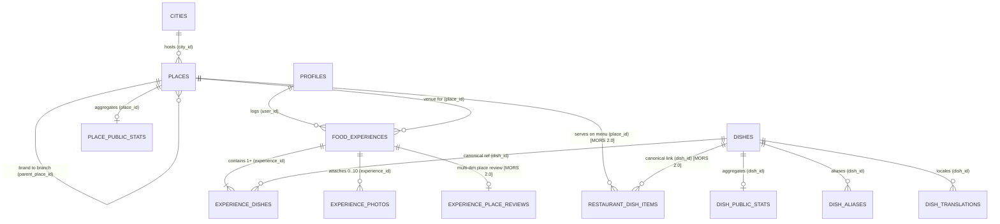

# MORS 2.0 — Data Model, Rating Semantics & RLS Architecture Audit

- **Audit Phase:** Phase 0 — Product Specification & Repository Reality Audit
- **Git Commit SHA:** `dd12d32ecf7c3ce51a3853bc54e89642f949c47e`
- **Timestamp:** `2026-11-12T00:18:00+05:30`
- **Evidence Links:**
  - [EV-001: Repository & Test Baseline](file:///c:/Users/mukes/OneDrive/Desktop/MORS/docs/evidence/phase-0/EV-001-repo-and-test-baseline.md)
  - [EV-002: Live PostgreSQL Schema & RLS Inventory](file:///c:/Users/mukes/OneDrive/Desktop/MORS/docs/evidence/phase-0/EV-002-schema-and-rls-inventory.md)
  - [EV-003: Rating, Search & Privacy Trace](file:///c:/Users/mukes/OneDrive/Desktop/MORS/docs/evidence/phase-0/EV-003-rating-search-and-privacy-trace.md)

---

## 1. Current Database Schema Inventory (Core Domain & Discovery Tables)

The live PostgreSQL database (`supabase_db_MORS`, 33 applied migrations) contains **51 base tables** in the `public` schema ([EV-002](file:///c:/Users/mukes/OneDrive/Desktop/MORS/docs/evidence/phase-0/EV-002-schema-and-rls-inventory.md)). Below is the detailed inventory of the core tables governing food experiences, dishes, places, ratings, aggregates, and discovery.

| Table Name | Migration Origin | Primary Key & Core Columns | Foreign Keys | RLS Enabled & Policies | Triggers Attached |
|---|---|---|---|---|---|
| `public.profiles` | `01`, `13`, `26`, `30`, `33` | `id` (UUID PK), `username`, `display_name`, `bio`, `avatar_path`, `is_private` (bool), `discoverable` (bool), `timezone`, `locale`, `city_id`, `is_admin`, `deletion_requested_at`, `deletion_pending_at`, `experiences_count`, `followers_count`, `following_count` | `id -> auth.users(id)`, `city_id -> cities(id)` | Yes: `SELECT` (owner OR unblocked & discoverable/permitted), `UPDATE` (owner) | `set_profiles_updated_at`, `trg_guard_profile_columns`, `on_profile_deleted` (**Missing:** public-pool stats recompute trigger) |
| `public.food_experiences` | `01`, `13` | `id` (UUID PK), `user_id`, `client_request_id`, `title`, `description`, `category_slug`, `status` (`draft`/`published`), `visibility` (`public`/`followers`/`private`), `overall_rating` (`smallint 1..10`), `eaten_at`, `eaten_date`, `published_at`, `place_id`, `price_amount`, `price_currency`, `cuisine`, `tags` (`text[]`), `likes_count`, `comments_count` | `user_id -> profiles(id)`, `place_id -> places(id)` | Yes: `SELECT` (`can_view_experience`), `INSERT`/`UPDATE`/`DELETE` (owner) | `on_experience_maintain_stats` -> `trigger_on_experience_change()`, `set_experiences_updated_at` |
| `public.experience_dishes` | `01` | `id` (UUID PK), `experience_id`, `dish_id`, `display_name`, `position`, `rating` (`smallint 1..10`), `note`, `created_at` | `experience_id -> food_experiences(id) CASCADE`, `dish_id -> dishes(id) SET NULL` | Yes: `SELECT` (`can_view_experience`), `ALL` (owner of parent experience) | `on_experience_dishes_maintain_stats` -> `trigger_on_experience_dishes_change()` |
| `public.experience_photos` | `01`, `13` | `id` (UUID PK), `experience_id`, `storage_path`, `thumbnail_path`, `width`, `height`, `blurhash`, `alt_text`, `position` | `experience_id -> food_experiences(id) CASCADE` | Yes: `SELECT` (`can_view_experience`), `ALL` (owner) | `on_experience_photo_deleted` -> `handle_deleted_experience_photo()` |
| `public.dishes` | `01`, `13` | `id` (UUID PK), `name`, `normalized_name`, `slug` (UNIQUE), `cuisine`, `description`, `merged_into_id`, `created_by`, `is_listed` (bool, default `false`), `created_at` | `merged_into_id -> dishes(id)`, `created_by -> profiles(id)` | Yes, **BROKEN**: `SELECT USING (true)` exposes `is_listed = false` and `created_by` | None |
| `public.dish_aliases` | `01` | `id` (UUID PK), `dish_id`, `alias`, `normalized_alias` (UNIQUE) | `dish_id -> dishes(id) CASCADE` | Yes: `SELECT USING (true)`, `INSERT` (authenticated) | None |
| `public.dish_translations` | `17` | `dish_id`, `locale` (`en`/`te`/`hi`), `name`, `transliteration` (PK: `dish_id, locale`) | `dish_id -> dishes(id) CASCADE` | Yes: `SELECT USING (true)`, `ALL` (admin) | None |
| `public.dish_public_stats` | `01` (view), `14` (table) | `dish_id` (UUID PK), `public_experience_count` (`bigint`), `public_rating_count` (`bigint`), `public_rating_avg` (`numeric(4,2)`), `updated_at` | `dish_id -> dishes(id) CASCADE` | Yes: `SELECT USING (true)` | Maintained by `recompute_dish_stats` |
| `public.places` | `01`, `13`, `20`, `26` | `id` (UUID PK), `name`, `normalized_name`, `city`, `city_id`, `country`, `address`, `lat`, `lng`, `parent_place_id`, `merged_into_id`, `created_by`, `is_listed` (bool, default `false`), `source_attribution`, `last_synced_at` | `parent_place_id -> places(id)`, `merged_into_id -> places(id)`, `city_id -> cities(id)`, `created_by -> profiles(id)` | Yes, **BROKEN**: `SELECT USING (true)` exposes `is_listed = false` and `created_by` | None |
| `public.place_public_stats` | `01` (view), `14` (table) | `place_id` (UUID PK), `public_experience_count` (`bigint`), `public_rating_avg` (`numeric(4,2)`), `updated_at` (**Missing:** `public_rating_count`) | `place_id -> places(id) CASCADE` | Yes: `SELECT USING (true)` | Maintained by `recompute_place_stats` |
| `public.cities` | `26` | `id` (UUID PK), `slug` (UNIQUE), `name`, `name_local`, `state`, `country`, `lat`, `lng`, `timezone`, `is_active` | None | Yes: `SELECT USING (true)`, `ALL` (admin) | None |
| `public.explore_cache` | `19` | `id` (UUID PK), `scope`, `city`, `kind`, `payload` (`jsonb`), `computed_at` | None | Yes: `SELECT USING (true)`, `ALL USING (false)` | None |
| `public.user_stats_owner` & `public.user_stats_public` | `18` | `(user_id, period)` PK, `data` (`jsonb`), `computed_at` | `user_id -> profiles(id) CASCADE` | Yes: owner-only for `user_stats_owner`; public-profile unblocked for `user_stats_public` | Recomputed via `recompute_user_stats` (**BROKEN** due to `fe.rating` typo) |

---

## 2. Entity-Relationship Diagram (Current vs. MORS 2.0 Target)

---

## 3. End-to-End Current Rating Trace & Semantic Flaws

### 3.1 Where Ratings Live Today ([EV-003](file:///c:/Users/mukes/OneDrive/Desktop/MORS/docs/evidence/phase-0/EV-003-rating-search-and-privacy-trace.md))
1. **Storage Representation:**
   - `public.food_experiences.overall_rating`: `smallint` constrained to `1..10` (nullable).
   - `public.experience_dishes.rating`: `smallint` constrained to `1..10` (nullable).
2. **Domain Helpers ([packages/domain/src/ratings.ts](file:///c:/Users/mukes/OneDrive/Desktop/MORS/packages/domain/src/ratings.ts)):**
   - `dbRatingToDisplay(dbRating)` divides by `2` (`1..10` -> `0.5..5.0`).
   - `displayRatingToDb(displayRating)` multiplies by `2` and rounds (`0.5..5.0` -> `1..10`).
3. **Logging Form ([apps/web/src/components/log/LogModal.tsx](file:///c:/Users/mukes/OneDrive/Desktop/MORS/apps/web/src/components/log/LogModal.tsx#L494-L507)):**
   - In Quick Log mode, a single `RatingStars` input writes the exact same integer to **both** `dishes[0].rating` and `overallRating`.
   - In Detailed mode (`isDetailedOpen = true`), each dish row has its own `RatingStars` (`dishes[idx].rating`), and there is **no separate input** for `overallRating` or restaurant-specific ratings. If a user edits Dish #1's rating inside the detailed dish list, `overallRating` stays stale at its previous value (or `null` if the user skipped the top rating and only rated inside the detailed dish list).
4. **Trigger Aggregation ([supabase/migrations/20261110000014_trigger_maintained_stats.sql](file:///c:/Users/mukes/OneDrive/Desktop/MORS/supabase/migrations/20261110000014_trigger_maintained_stats.sql#L69-L120)):**
   - `recompute_dish_stats(p_dish_id)` averages `ed.rating` across public-pool entries where `ed.dish_id = p_dish_id`.
   - `recompute_place_stats(p_place_id)` averages `fe.overall_rating` across public-pool entries where `fe.place_id = p_place_id`.

### 3.2 Five Structural Defects in Current Rating Architecture
1. **Conflation of Meal Experience Rating with Restaurant Rating:**
   - `food_experiences.overall_rating` represents the user's overall eating occasion (including home-cooked meals where `place_id IS NULL`). Using `avg(fe.overall_rating)` as `place_public_stats.public_rating_avg` means there is no distinction between how much someone enjoyed their company/occasion and their evaluation of the restaurant's food quality, service, ambience, hygiene, or value for money.
2. **UI Coupling Between Primary Dish Rating and Overall Experience Rating:**
   - Because `LogModal.tsx` sets `overallRating = dishes[0].rating` on the primary star control, a user who logs a 5-star Chicken 65 appetizer and a 2-star Biryani main course at a restaurant automatically gives the restaurant a `5.0` `overall_rating` unless they know how the internal state is wired.
3. **Missing `public_rating_count` on `place_public_stats`:**
   - `place_public_stats` only stores `public_experience_count` and `public_rating_avg`. On `/place/[id]` ([apps/web/src/app/place/\[id\]/page.tsx](file:///c:/Users/mukes/OneDrive/Desktop/MORS/apps/web/src/app/place/%5Bid%5D/page.tsx#L105)), the minimum consensus threshold checks `place.stats.publicExperienceCount >= 3`. If 3 users log unrated experiences (`overall_rating IS NULL`) or 2 log unrated experiences and 1 logs a rated experience, `/place/[id]` bypasses the 3-rating privacy/consensus threshold!
4. **No Multi-Dimensional Sub-Ratings:**
   - MORS 2.0 requires structured restaurant sub-ratings (`food_quality`, `value_for_money`, `ambience`, `service`, `hygiene`) and optional dish sub-ratings (`taste`, `portion`, `value`) plus dish tags/spice level and restaurant context (`dining_type`, `price_tier`, `would_return`). None of these columns or tables exist.
5. **Broken SQL Column in `recompute_user_stats`:**
   - [20261110000018_phase16_taste_stats.sql](file:///c:/Users/mukes/OneDrive/Desktop/MORS/supabase/migrations/20261110000018_phase16_taste_stats.sql#L94) queries `AVG(fe.rating)` instead of `AVG(fe.overall_rating)`, causing `recompute_user_stats` to fail at runtime if invoked.

---

## 4. Brand vs. Branch Identity Analysis (`public.places`)

### 4.1 Current State
- `public.places` is a single self-referencing table with `parent_place_id UUID REFERENCES public.places(id) ON DELETE SET NULL` and `merged_into_id UUID REFERENCES public.places(id) ON DELETE SET NULL` ([20261110000001_initial_schema.sql](file:///c:/Users/mukes/OneDrive/Desktop/MORS/supabase/migrations/20261110000001_initial_schema.sql#L71-L86)).
- On `/place/[id]` ([apps/web/src/app/dish/actions.ts](file:///c:/Users/mukes/OneDrive/Desktop/MORS/apps/web/src/app/dish/actions.ts#L255-L276)), if a place has `parent_place_id`, it displays `"Branch location of <Parent Name>"`, and queries child rows where `parent_place_id = canonicalPlace.id` to list `"Other Branches"`.
- In `supabase/seed.sql`, `Paradise Biryani` (`20000000-0000-0000-0000-000000000001`, Secunderabad) is the parent row, and `Paradise Biryani - Hitec City` (`20000000-0000-0000-0000-000000000006`) has `parent_place_id = '20000000-0000-0000-0000-000000000001'`.

### 4.2 Gaps for MORS 2.0 Hyderabad Discovery
1. **Parent Place Conflates Brand Entity with Flagship Branch:**
   - In `seed.sql`, the parent row (`Paradise Biryani`) is simultaneously a physical Secunderabad branch (with street address and coordinates) AND the parent of the Hitec City branch. When viewing the Hitec City branch (`parent_place_id = Secunderabad`), the query `.eq('parent_place_id', canonicalPlace.id)` returns **0 branches** because sibling branches point to the parent, not to each other!
2. **Missing Rich Venue Metadata on `public.places`:**
   - `places` currently has only: `id`, `name`, `normalized_name`, `city`, `city_id`, `country`, `address`, `lat`, `lng`, `parent_place_id`, `merged_into_id`, `created_by`, `is_listed`, `source_attribution`, `last_synced_at`.
   - Missing for MORS 2.0 Find Restaurants & Restaurant Profile pages:
     - `slug` (URL-friendly unique identifier; `/place/[id]` currently uses raw UUIDs unlike `/dish/[slug]`)
     - `area_name` / `neighborhood` (critical in Hyderabad: Jubilee Hills, Banjara Hills, Gachibowli, Hitec City, Charminar, Secunderabad, Madhapur, Kondapur)
     - `cuisines` (`text[]`, e.g., `{'Hyderabadi', 'Mughlai'}`)
     - `venue_type` / `dining_style` (`fine_dining`, `casual_dining`, `cafe`, `quick_bite`, `street_food`, `sweet_shop`, `bakery`, `cloud_kitchen`, `mess_tiffin`)
     - `price_tier` (`smallint 1..4` representing `₹`, `₹₹`, `₹₹₹`, `₹₹₹₹` or `avg_cost_for_two integer`)
     - `dietary_classification` (`pure_veg`, `veg_friendly`, `non_veg`, `halal`, `jain_available`)
     - `is_brand_parent` (boolean to distinguish a brand umbrella from a physical branch, or optional roll-up stats across branches)

---

## 5. Canonical Dish vs. Restaurant-Specific Dish Item Analysis

### 5.1 Current State
- `public.dishes` represents the **Canonical Dish** (e.g., `Hyderabadi Mutton Dum Biryani`, `Masala Dosa`, `Irani Chai`).
- `public.experience_dishes` links a `food_experience` (which optionally has a `place_id`) to a `dish_id` (plus free-text `display_name`, `rating`, `note`).
- There is **no table or aggregate** representing **Dish-at-Place** (`(place_id, dish_id)`), i.e., "Mutton Dum Biryani *at* Shah Ghouse, Tolichowki".

### 5.2 Why This Blocks MORS 2.0 Core Discovery ("Find Food" & "Where to Eat This Dish")
- When a user searches **Find Food** for `"Mutton Biryani"` in Hyderabad or visits `/dish/hyderabadi-mutton-dum-biryani`, MORS 2.0 must answer:
  1. What is the community consensus on this canonical dish overall? (`dish_public_stats`)
  2. **Which restaurants in Hyderabad serve the best version of this dish**, ranked by public-pool dish ratings *at each specific restaurant*, with sample count, price range, and area?
- Conversely, when a user visits a restaurant page (`/place/[id]`), MORS 2.0 must answer:
  1. What is the restaurant's overall and 5-dimension rating breakdown? (`place_public_stats`)
  2. **What are the best / most-logged dishes at this specific restaurant** ("What to Order Here" / Community Menu), ranked by dish ratings logged at that `place_id`?
- Without a trigger-maintained `place_dish_public_stats` (or `restaurant_dish_stats`) table keyed by `(place_id, dish_id)` and optional `price_amount` on `experience_dishes`, every dish comparison query would require scanning and grouping all historical `experience_dishes JOIN food_experiences JOIN profiles` at read time.

---

## 6. Aggregate Table Design Options & Recommendation

### Option A: Extend Existing Trigger-Maintained Tables + Add `place_dish_public_stats` (Recommended)
1. **`public.place_public_stats` (Extend in Phase 1/2):**
   - Add `public_rating_count bigint NOT NULL DEFAULT 0` (fixes the threshold defect on `/place/[id]`).
   - Add multi-dimensional average & count columns:
     - `food_quality_avg numeric(4,2)`, `food_quality_count bigint NOT NULL DEFAULT 0`
     - `value_for_money_avg numeric(4,2)`, `value_for_money_count bigint NOT NULL DEFAULT 0`
     - `ambience_avg numeric(4,2)`, `ambience_rating_count bigint NOT NULL DEFAULT 0`
     - `service_avg numeric(4,2)`, `service_rating_count bigint NOT NULL DEFAULT 0`
     - `hygiene_avg numeric(4,2)`, `hygiene_rating_count bigint NOT NULL DEFAULT 0`
     - `would_return_pct numeric(5,2)` (optional)
2. **`public.dish_public_stats` (Extend in Phase 1/2):**
   - Retain `public_experience_count`, `public_rating_count`, `public_rating_avg`.
   - Add optional sub-dimension columns:
     - `taste_avg numeric(4,2)`, `portion_avg numeric(4,2)`, `value_avg numeric(4,2)`
     - `public_place_count bigint NOT NULL DEFAULT 0` (number of distinct public-pool places where this dish is logged).
3. **`public.place_dish_public_stats` (New Trigger-Maintained Table in Phase 2):**
   - Primary Key: `(place_id, dish_id)`.
   - Columns: `public_experience_count bigint`, `public_rating_count bigint`, `public_rating_avg numeric(4,2)`, `taste_avg numeric(4,2)`, `portion_avg numeric(4,2)`, `value_avg numeric(4,2)`, `latest_price_inr numeric(10,2)`, `updated_at timestamptz`.
   - Maintained automatically by `recompute_place_dish_stats(p_place_id, p_dish_id)` whenever a public-pool experience with both `place_id` and `dish_id` is inserted, updated, or deleted, or when a profile's public-pool eligibility changes.

### Option B: Dynamic SQL Views (`security_invoker = true`)
- **Rejected:** Violates `AGENTS.md` Non-Negotiable #10 (*"Aggregates are trigger-maintained tables, never viewer-dependent views"*) and degrades performance under pagination/sorting on Find Food and Find Restaurants.

---

## 7. Historical Data Migration & Backwards Compatibility Assessment

1. **Preserving Existing `food_experiences.overall_rating` and `experience_dishes.rating`:**
   - Existing rows have `overall_rating` (`1..10`) on `food_experiences` and `rating` (`1..10`) on `experience_dishes`.
   - In Phase 1, we should introduce explicit restaurant rating columns on `food_experiences` (or a 1:1 `experience_place_reviews` table / nullable columns on `food_experiences`: `place_rating_overall`, `place_rating_food`, `place_rating_value`, `place_rating_ambience`, `place_rating_service`, `place_rating_hygiene`, `would_return`) while keeping `overall_rating` intact as the overall meal/experience rating.
   - For historical public-pool entries where `place_id IS NOT NULL` and `overall_rating IS NOT NULL` but `place_rating_overall IS NULL`, `recompute_place_stats` can either:
     - Use `COALESCE(fe.place_rating_overall, fe.overall_rating)` for overall place rating while computing sub-dimension averages (`food_quality`, `value_for_money`, `ambience`, `service`, `hygiene`) strictly over rows where those sub-dimensions are non-null (Recommended — zero data loss for existing beta logs), OR
     - Backfill `place_rating_overall = overall_rating` for existing rows where `place_id IS NOT NULL`.
2. **Half-Star Integer Encoding (`1..10` DB / `0.5..5.0` UI):**
   - All new sub-ratings (`food_quality`, `value_for_money`, `ambience`, `service`, `hygiene`, `taste`, `portion`, `value`) MUST use the exact same `smallint` `1..10` (`CHECK (col >= 1 AND col <= 10)`) convention as `overall_rating` and `experience_dishes.rating` so all domain helpers (`dbRatingToDisplay`, `displayRatingToDb`, `RatingStars`) work uniformly without scale conversion bugs.

---

## 8. Security & RLS Implications (Critical Fixes Required in Phase 1 & Phase 2)

| ID | Issue | Current State | Required Fix |
|---|---|---|---|
| **SEC-01** | Unlisted `dishes` and `places` readable by all clients via RLS | `dishes` and `places` have `FOR SELECT USING (true)` ([EV-002](file:///c:/Users/mukes/OneDrive/Desktop/MORS/docs/evidence/phase-0/EV-002-schema-and-rls-inventory.md)) | Replace `SELECT` policies on `dishes` and `places` with `USING (is_listed = true OR created_by = (SELECT auth.uid()) OR EXISTS (SELECT 1 FROM public.profiles p WHERE p.id = (SELECT auth.uid()) AND p.is_admin = true))`. Update `search_all`, `find_similar_dishes`, and `find_similar_places` to enforce the same predicate. |
| **SEC-02** | `created_by` column on `dishes` and `places` exposed to clients | `SELECT *` on `dishes` / `places` returns `created_by` | Revoke public column access or expose safe projection/RPCs and ensure client queries never select `created_by` (only compare `created_by = (SELECT auth.uid())` inside RLS/RPCs). |
| **SEC-03** | Profile privacy/deletion changes do not trigger public-pool aggregate recomputation | No trigger on `public.profiles` when `is_private`, `discoverable`, `deletion_requested_at`, or `deletion_pending_at` changes | Add `AFTER UPDATE OF is_private, discoverable, deletion_requested_at, deletion_pending_at ON public.profiles` trigger that calls `recompute_dish_stats`, `recompute_place_stats`, and `recompute_place_dish_stats` for all dishes and places logged by that user. Also check both `deletion_requested_at IS NULL AND deletion_pending_at IS NULL` in all public-pool predicates. |
| **SEC-04** | Private-profile experiences visible to accepted followers leak into public lists on `/dish/[slug]` and `/place/[id]` | `getDishBySlug` and `getPlaceById` filter by `status = 'published' AND visibility = 'public'` without filtering `profiles.is_private = false AND profiles.discoverable = true` ([EV-003](file:///c:/Users/mukes/OneDrive/Desktop/MORS/docs/evidence/phase-0/EV-003-rating-search-and-privacy-trace.md)) | Filter `profiles!inner(username, display_name, is_private, discoverable, deletion_requested_at, deletion_pending_at)` with `is_private = false`, `discoverable = true`, `deletion_requested_at IS NULL`, `deletion_pending_at IS NULL` on all public entity page lists. |
| **SEC-05** | `merge_dishes` and `merge_places` omit newer FK tables and stats recomputation | `merge_dishes` misses `collection_items`, `dish_translations`, `dish_similarity`; `merge_places` misses `collection_items` | Update `merge_dishes` and `merge_places` to re-point all FK references (including new `place_dish_public_stats`) and invoke `recompute_dish_stats` / `recompute_place_stats` for both source and target IDs. |
