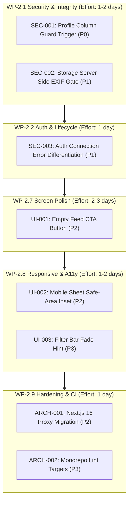

# MORS Prioritised Bug Backlog

**Report File:** `docs/audit/PRIORITISED_BUG_BACKLOG.md`  
**Milestone:** M1 Reality Audit — Work Package WP-1.6  
**Audit Date:** 2026-11-11  
**Auditor:** Antigravity Agent  
**Baseline Git Tag:** `pre-audit`  
**Branch:** `audit/wp-1.6-synthesis`

---

## 1. Prioritised Findings Master Table

| ID | Title | Severity | Effort | Batch (Milestone 2) | Depends On | Status | Proposed Fix |
|----|-------|----------|--------|---------------------|------------|--------|--------------|
| **SEC-001** | Unrestricted Column-Level Update on `public.profiles` (`role`, counters) | **P0** | S | WP-2.1 (Security & Data Integrity) | None | Open | Add PostgreSQL `BEFORE UPDATE` trigger `guard_profile_columns()` preventing user tampering with `role` or counters |
| **SEC-002** | Direct Raw Storage API Uploads Bypass Client Canvas EXIF Stripping | **P1** | M | WP-2.1 (Security & Data Integrity) | None | Open | Add Edge Function / Storage Webhook validating MIME and stripping EXIF on raw uploads |
| **SEC-003** | Auth Sign-up Action Swallows Network Failure as Invalid Invite Code | **P1** | S | WP-2.2 (Auth & Lifecycle) | None | Open | Differentiate `fetch failed` / `ECONNREFUSED` from `!isValid` in `apps/web/src/app/auth/actions.ts` |
| **UI-001** | Cold-Start Empty Feed Lacks Direct First-Log CTA Button | **P2** | S | WP-2.7 (Screen Redesign) | None | Open | Wire `EmptyState` component with a primary "Log your first meal" action trigger |
| **UI-002** | Mobile Modal Sheet Overlaps Hardware Home-Bar on 360px Viewport | **P2** | S | WP-2.8 (Responsive & A11y) | None | Open | Add `pb-[env(safe-area-inset-bottom,16px)]` to modal sheet containers |
| **ARCH-001**| Next.js 16 Deprecation Warning on `middleware.ts` | **P2** | S | WP-2.9 (Hardening) | None | Open | Migrate `apps/web/src/middleware.ts` to `apps/web/src/proxy.ts` per Next.js 16 standard |
| **ARCH-002**| Root `turbo lint` Missing Workspace Script Targets | **P3** | S | WP-2.9 (Hardening) | None | Open | Add standard `lint` scripts to package manifests |
| **UI-003** | Horizontal Filter Bar Overflow Lacks Right Fade Cue on Small Screens | **P3** | S | WP-2.8 (Responsive & A11y) | None | Open | Add subtle CSS mask gradient to scrollable chip list container |

---

## 2. Milestone 2 Remediation Work Package Mapping

