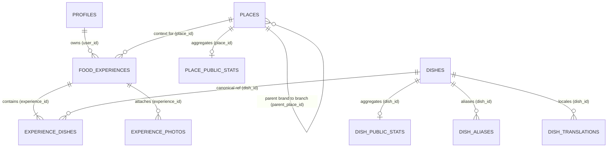

# MORS Phase 1 — Target Data Model Specification

- **Phase:** 1 — Rating Architecture & Data Model Foundation
- **Deliverable:** `docs/phase-1/TARGET_DATA_MODEL.md`
- **Date:** 2026-11-12

---

## 1. Conceptual Entity-Relationship Diagram



---

## 2. Table Specifications & Constraints (Phase 1 Changes)

### 2.1 Table `public.food_experiences`
- **Primary Key:** `id UUID DEFAULT gen_random_uuid()`
- **Foreign Keys:**
  - `user_id UUID REFERENCES public.profiles(id) ON DELETE CASCADE`
  - `place_id UUID REFERENCES public.places(id) ON DELETE SET NULL`
- **Rating Columns Added in Phase 1:**
  ```sql
  place_rating_overall SMALLINT CHECK (place_rating_overall BETWEEN 1 AND 10),
  place_rating_food SMALLINT CHECK (place_rating_food BETWEEN 1 AND 10),
  place_rating_value SMALLINT CHECK (place_rating_value BETWEEN 1 AND 10),
  place_rating_ambience SMALLINT CHECK (place_rating_ambience BETWEEN 1 AND 10),
  place_rating_service SMALLINT CHECK (place_rating_service BETWEEN 1 AND 10),
  place_rating_hygiene SMALLINT CHECK (place_rating_hygiene BETWEEN 1 AND 10),
  dining_context TEXT CHECK (dining_context IN ('dine_in', 'takeaway', 'street_stall')),
  would_return BOOLEAN
  ```
- **Integrity Constraint:**
  ```sql
  CONSTRAINT check_place_ratings_require_place CHECK (
    place_id IS NOT NULL OR (
      place_rating_overall IS NULL AND
      place_rating_food IS NULL AND
      place_rating_value IS NULL AND
      place_rating_ambience IS NULL AND
      place_rating_service IS NULL AND
      place_rating_hygiene IS NULL AND
      dining_context IS NULL AND
      would_return IS NULL
    )
  )
  ```

### 2.2 Table `public.experience_dishes`
- **Primary Key:** `id UUID DEFAULT gen_random_uuid()`
- **Foreign Keys:**
  - `experience_id UUID REFERENCES public.food_experiences(id) ON DELETE CASCADE`
  - `dish_id UUID REFERENCES public.dishes(id) ON DELETE SET NULL`
- **Sub-Rating & Metadata Columns Added in Phase 1:**
  ```sql
  taste_rating SMALLINT CHECK (taste_rating BETWEEN 1 AND 10),
  portion_rating SMALLINT CHECK (portion_rating BETWEEN 1 AND 10),
  value_rating SMALLINT CHECK (value_rating BETWEEN 1 AND 10),
  price_amount NUMERIC(10,2) CHECK (price_amount >= 0),
  dietary_tag TEXT CHECK (dietary_tag IN ('veg', 'egg', 'non_veg')),
  spice_level SMALLINT CHECK (spice_level BETWEEN 1 AND 4)
  ```

### 2.3 Table `public.place_public_stats`
- **Primary Key:** `place_id UUID REFERENCES public.places(id) ON DELETE CASCADE`
- **Columns Added in Phase 1:**
  ```sql
  public_rating_count BIGINT NOT NULL DEFAULT 0,
  food_quality_avg NUMERIC(4,2),
  food_quality_count BIGINT NOT NULL DEFAULT 0,
  value_for_money_avg NUMERIC(4,2),
  value_for_money_count BIGINT NOT NULL DEFAULT 0,
  ambience_avg NUMERIC(4,2),
  ambience_count BIGINT NOT NULL DEFAULT 0,
  service_avg NUMERIC(4,2),
  service_count BIGINT NOT NULL DEFAULT 0,
  hygiene_avg NUMERIC(4,2),
  hygiene_count BIGINT NOT NULL DEFAULT 0,
  would_return_pct NUMERIC(5,2)
  ```

### 2.4 Table `public.dish_public_stats`
- **Primary Key:** `dish_id UUID REFERENCES public.dishes(id) ON DELETE CASCADE`
- **Columns Added in Phase 1:**
  ```sql
  taste_avg NUMERIC(4,2),
  portion_avg NUMERIC(4,2),
  value_avg NUMERIC(4,2)
  ```
